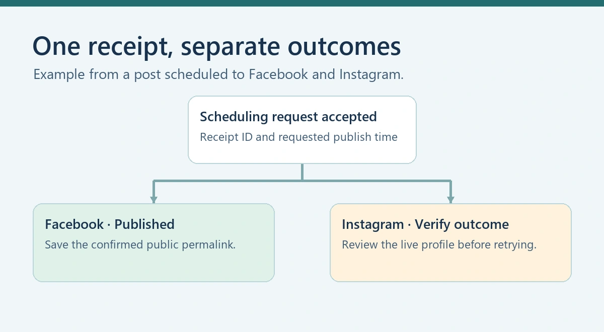

# Design a scheduling receipt that preserves each destination’s outcome

When a user submits one post to Facebook and Instagram, the app needs to answer two questions. Did it accept the request, and what happened at each destination? Put those answers in different parts of the receipt so an uncertain provider result can be investigated without resending the whole batch.

## Give the original request an identifier

When a client times out during submission, it needs a way to find the existing work instead of scheduling another copy. Postzyo can accept an idempotency key and associate it with the authenticated user and a fingerprint of the request. The fingerprint represents details such as the destinations, publish time, message and media. Reusing the same key with different content returns a conflict. A legitimate replay of the same request returns the existing result.

The receipt records acceptance. Each destination carries its own publication status. Its identifier lets the operator connect later queue records to the original submission without copying captions or credentials into a bug report.

## Keep one row per destination

Give each destination its own row and status. Include the account, requested time and any provider reference that can help verify delivery. For example, a combined workshop announcement may have a confirmed Facebook post while Instagram returns an uncertain result. Record the observed public Facebook link and keep investigating the Instagram row. The Facebook row already has its own evidence.

## Exercise the states that change an operator’s decision

Run these checks with test fixtures before exercising approved external destinations.

1. Send the same request twice using the same key and payload. Confirm the returned receipt and destination row IDs agree.
2. Reuse the key with an altered caption. Confirm the service rejects the conflicting request.
3. Return success for Facebook and an uncertain result for Instagram. Confirm the response and queue preserve the two outcomes.
4. Confirm the operator can find the affected account, original schedule and provider status without reopening the composer.

When the provider might have accepted a post before the connection failed, check the public destination and available provider history before creating any replacement. The request key can help with a client-side resubmission. The provider-side outcome still requires its own evidence.

[Postzyo’s guide to posts that are still processing](https://postzyo.com/blog/handle-scheduled-social-post-still-processing/) shows how to make that distinction in a publishing handoff.
