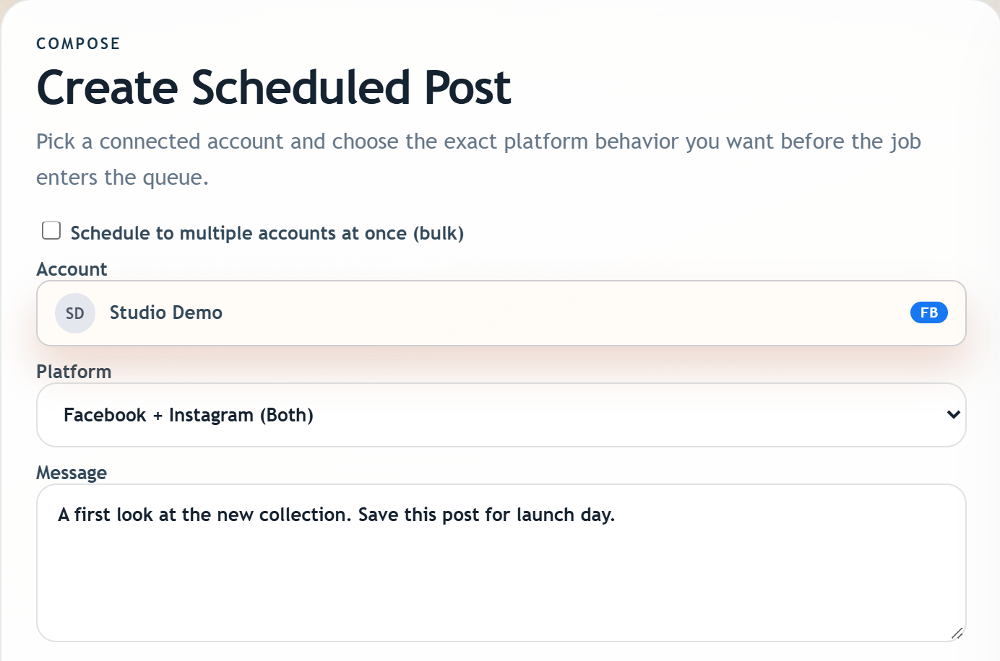

# A delivery checklist for scheduled Facebook and Instagram posts

One scheduling submission can have two different outcomes. Facebook can publish while Instagram is processing its video, or Instagram can succeed while Facebook returns a permission error. Use one row per destination in your handoff so a team member can see exactly what still needs attention.

## Before the scheduled time

1. Record the Facebook Page and Instagram profile names. Confirm the Instagram professional profile is linked to the Page your team manages.
2. Open the media URL in a signed-out browser if the post uses a link. A login screen, an expired share link or a file preview page can prevent the publisher from fetching the actual file.
3. Note the requested time and its timezone. Use a full timestamp for handoffs across timezones. For example, 11:30 a.m. IST is 06:00 UTC on the same date.

## When one post is missing

| Queue status | What to check | Next action |
| --- | --- | --- |
| Scheduled | The requested time and device timezone | Compare the intended time with the queue before changing it. |
| Processing | The status note and platform | Allow time for provider processing. Video can take longer than a text post. |
| Retrying | The next attempt and reason shown | Let the scheduled retry run. |
| Failed or blocked | The exact platform error and the account’s current access | Correct the identified issue, then retry the affected destination if the queue offers that action. |
| Verify outcome | The live feed or publishing history for that destination | Look for the matching caption, media and time before submitting another copy. |
| Published | The specific destination and the expected content | Record the checked public URL if your team tracks delivery. |

For a Friday class announcement, imagine the Facebook link is already live but the Instagram row says **Verify outcome**. Open the linked Instagram profile and check for the same class image and caption. If it is there, record what you found and leave the Facebook row alone. If the result remains unclear, give support the platform, intended time, media type and status note. Keep access tokens and passwords out of support requests.

[Postzyo](https://postzyo.com/) provides a separate Scheduler status for each destination. The same checklist also works when a team uses Meta’s own publishing tools.
