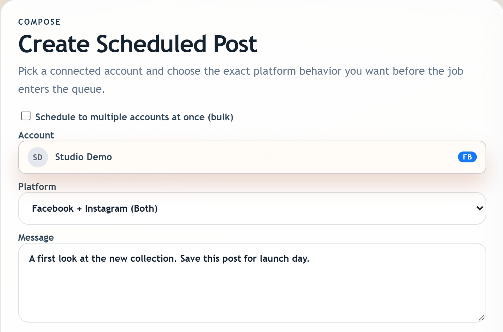

# A staging release rehearsal for Facebook and Instagram publishing

A release can pass its backend tests while a real Page connection, media upload or delivery confirmation still fails. A useful rehearsal checks what the application scheduled and what each platform actually published. Give the person running the test a written scope and a simple record of what counts as a pass.

## Agree on destinations and a stop condition

Use a staging environment and Facebook and Instagram test destinations approved for visible posts. Confirm who can publish there and who can remove test content after the rehearsal. Choose a date and time far enough ahead to check the queue before it runs. Use a sample image or video your team owns and a caption that clearly identifies the run, such as “Staging publishing check P17.” Keep one distinct label per run so a previous test cannot be mistaken for the current result.

## Test the paths the release can affect

Start with a successful submission. Confirm the expected destination rows, the time and the file. If the release changes uploads, test with the upload route and a supported media format. If it changes link handling, test a stable public URL and confirm the file stays available through the scheduled time. Use test fixtures or a mock provider to exercise errors such as missing permission and ambiguous delivery. Reserve real posting for the approved test destinations.

| Check | Expected evidence | Result to record |
| --- | --- | --- |
| Submit once | One queue entry per selected destination with the requested time | Queue status and platform |
| Confirm Facebook delivery | One matching post on the approved Facebook Page | Public permalink and observed time |
| Confirm Instagram delivery | One matching post on the approved Instagram profile | Public permalink and observed time |
| Verify an uncertain result | The reviewer checks the intended destination before sending another copy | Matching public post or named reviewer and next check |
| Complete agreed cleanup | Test content handled as agreed with the account owner | Cleanup status and reviewer |

If Facebook publishes but Instagram is still processing, leave the confirmed Facebook result in the record and investigate the Instagram row. For a release affecting rescheduling, use a separate approved test and verify that the original time produces no post and the updated time produces one. Log only the information a teammate needs to reproduce the check, such as the run label, destination, local and UTC times, media route and status. Keep credentials and private account details out of the report.

## Keep the rollout decision tied to the evidence

Have a second reviewer look at each affected platform and record which cases passed. Report any inaccessible destination or missing confirmation as pending. Fix the cause and rerun the affected case before expanding the rollout.

[Postzyo’s launch rehearsal guide](https://postzyo.com/blog/test-social-publishing-before-client-launch/) gives campaign operators a simpler handoff version of the same workflow.
