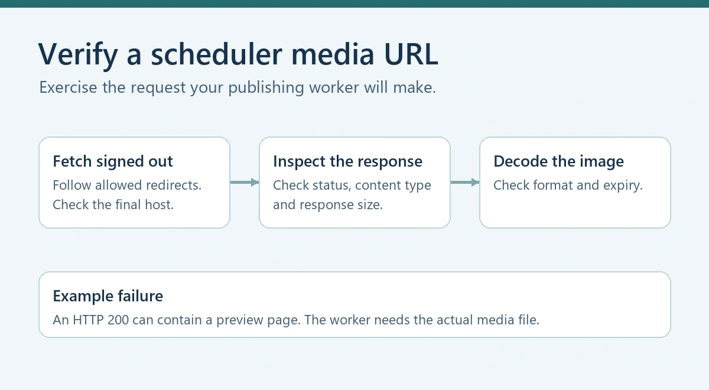

# How to verify a media URL from a scheduler worker

A media link that opens in the uploader's browser can fail in a worker. The browser may be signed in, show an HTML preview or follow a link that will expire before publication. A useful preflight checks the response the scheduled job will receive.

## Start outside the uploader’s session

Open a fresh session and fetch the exact saved URL without cookies, shared-drive credentials or application credentials. Compare the final destination with the expected media host. If the hosting service shows a preview page, use its supported direct-download route or upload the file through the scheduler. Keep the original media file and any access restrictions in the approval record.

## Inspect the payload as well as the status

Check the response status and media content type. Read enough of the response to confirm that it contains the expected format, and decode an image where the worker can do so within its size limits. For a video, confirm that the published URL stays within the provider's supported file type and size. If a server treats a header-only request differently from a normal download, verify with a bounded GET that reflects the real fetch path.

For worker implementations that fetch arbitrary URLs, apply the application’s outbound URL policy at each redirect. Keep byte and time limits in force while reading the body. Use a test fixture to exercise rejected redirects and oversized responses, so verification covers the safety checks as well as successful delivery.

## Check availability through publishing time

Temporary links need enough lifetime for the expected publish time and processing delay. Keep expiration times out of shared notes if they expose private signatures or tokens. A teammate can record the asset name, expected media type, time checked and whether its source is suitable for scheduling.

| Observed result | What to verify next |
| --- | --- |
| Status 200 with HTML | Find the supported file URL or upload the approved media |
| Sign-in redirect | Check whether the source is intended to be public |
| Image response but decode fails | Re-export the file, then repeat the download and decode |
| Valid temporary link | Verify it stays available through the publish window |

[Postzyo’s media URL checklist](https://postzyo.com/blog/check-media-url-before-scheduling/) explains the same checks from the publishing team’s point of view.
