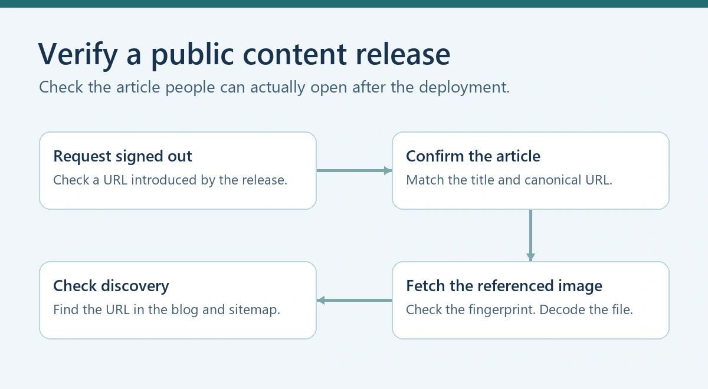

# How to verify a public content release after deployment

A deploy command can finish successfully before the new application process serves traffic. A build can also contain the right article while the reverse proxy still points to an earlier instance. For a public content release, verify a page introduced by the release and the assets that page actually references.

## Pick a URL that distinguishes the new release

Start with a new article path or a stable route with a newly added heading. Check the exact title, section or other observable change before calling the deployment healthy. A green homepage can stay green through an unsuccessful article rollout. Keep the expected public URL beside the released commit in the handoff.

Request the page signed out. Capture the status and final URL. If the response is temporarily unavailable during an approved restart, keep the check bounded and repeat against the same URL when the process has had time to start. Persistent errors should trigger the rollback criteria the team agreed to before deployment.

## Fetch the image the page actually serves

Read the image path from the returned HTML or the Article metadata and fetch that exact URL. In a Django deployment using static manifests, the public path can contain a fingerprint between the asset name and extension. Checking an unhashed source path separately can miss a broken reference. Confirm the returned content type is an image and, when possible, decode it. An error page can come back with status 200 from a proxy or storage fallback.

## Check canonical and discovery paths

Compare the page's canonical link and article metadata with the expected production URL. Exercise the alternate hostname using a deep path and a benign query value. Check the redirect target preserves both. Verify a link to the article appears in the public blog and that the sitemap contains the exact canonical URL. These checks establish that readers and crawlers can reach the article. A sitemap entry alone cannot confirm search indexing.

| Check | Evidence to save |
| --- | --- |
| New release is serving | Status 200 and the expected new heading on the public route |
| The illustration is reachable | Referenced asset URL, image content type and successful decode |
| Canonical routing works | Expected final URL after the alternate-host redirect |
| Public discovery works | Link in the blog index and exact entry in the sitemap |

[Postzyo’s guide to auditing old social links](https://postzyo.com/blog/audit-old-social-links-after-a-website-update/) covers the follow-up check for links people already received.
